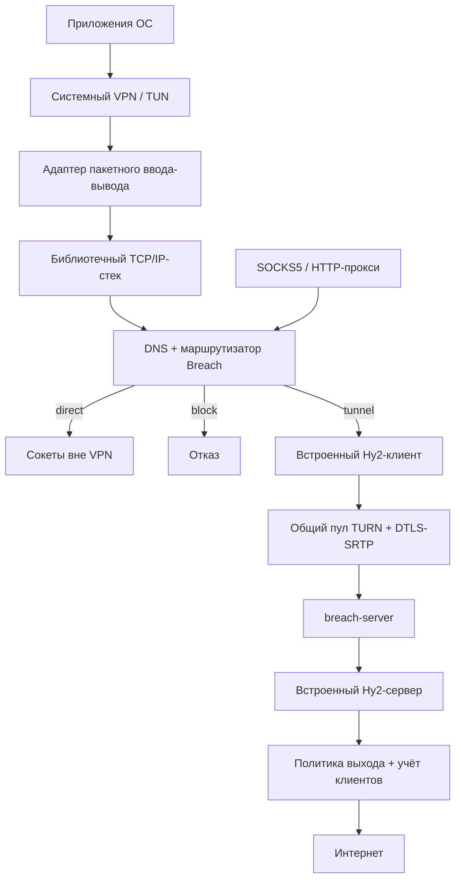

# Переход Breach на собственное ядро

Дата: 2026-09-15. Обновлено: 2026-09-17. Статус: Hy2-only принят; начаты этапы 0–1.
Основа: проверка текущего `core` на коммите `8edd853` и Android-приложения в `../android`.

Текущие результаты и команды: [прототип nativecore](../experiments/nativecore/README.md).
Есть пакетный bridge, локальные TCP/UDP/DNS-тесты, Linux TUN-адаптер и проверки
компиляции для пяти ОС. Встроенный Hy2-клиент и локальный SOCKS5 проверены
через живой MAX TURN на существующем Hy2 VPS. Этап 0 ещё не завершён: реальные
Linux TUN и мобильные устройства, ресурсы приложения требуют проверки.

Обновление 2026-09-17: общий роутер domain/IP/geo/port/network → tunnel/direct/block,
FakeDNS с постоянными FakeIP, native geodata-конвертер, подключение к Android
native engine и существующим per-app спискам. Собраны CLI и Android APK;
per-app на настольных ОС остаётся отдельной работой. Детали и ограничения:
[ROUTING.md](../experiments/nativecore/ROUTING.md).

Следующее обновление 2026-09-17: единый `breach run -config …` встраивает TURN
и Hy2/gVisor в один процесс. Есть автоматическое переподключение Hy2, сохранение
SOCKS/TUN при обрыве, наблюдение за сетевыми интерфейсами и отмена запуска.
TURN-пул переиспользуется из mobile-библиотеки; внутренний loopback UDP пока
сохранён. См. [UNIFIED.md](../experiments/nativecore/UNIFIED.md).

## 1. Цель и границы

Клиенты Android, iOS, Windows, macOS и Linux используют общее Go-ядро Breach
для VPN и прокси. Ядро обслуживает TCP/UDP, DNS, маршрутизацию, соединение с
exit-сервером и транспорт через TURN MAX/WB. В конечной поставке клиенту и
серверу не требуются sing-box/libbox и WireGuard. **Hysteria2 — единственный
протокол внутри туннеля**; используем официальную библиотеку, встроенную в Breach.
SOCKS5/HTTP существуют только локально на клиенте для приложений. Сервер принимает
Hy2 и открывает обычные TCP/UDP-сокеты, SOCKS-сервер ему не нужен.
Нашу внешнюю DTLS-SRTP/TURN-обёртку сохраняем.

«Собственное ядро» означает собственный движок и API с библиотеками сетевого
стека, QUIC и DTLS. Реализация TCP и криптографии с нуля в задачу не входит.

Под «всеми ОС» в этом плане понимаются пять перечисленных платформ. Серверная
поставка первого релиза — Linux amd64/arm64, контейнер и самостоятельный бинарник.
Клиентская переносимость не означает одинаковую установку, права и системные
функции на всех платформах. BSD и серверные службы Windows/macOS — расширение
матрицы после основной пятёрки. Настольным клиентам достаточно CLI/службы для
первого технического релиза; полноценный GUI — отдельная работа. iOS требует
приложения с расширением, один CLI-бинарник не является iOS-клиентом.

Предварительный порядок выпуска: **Android → Windows/Linux/macOS → iOS**.
Проверка технической осуществимости всех пяти платформ выполняется в начале,
включая iOS. Этот порядок — рабочее предположение до уточнения приоритетов.

## 2. Что уже есть и что предстоит заменить

| Компонент | Сейчас | Действие |
|---|---|---|
| MAX/WB, TURN, DTLS-SRTP | Работают в Go | Сохранить, переиспользовать |
| Пул релеев | Отдельные реализации в CLI и `mobile/core.go` | Свести в один движок с восстановлением мобильного ядра |
| Протокол туннеля | WG / Hy2 через sing-box / свой `qtun` | Только Hy2 через официальную библиотеку `apernet/hysteria/core/v2` |
| SOCKS5 TCP/UDP | `socks5` | Подключить к тому же маршрутизатору, что и TUN |
| HTTP-прокси | В Android через mixed inbound libbox | Реализовать CONNECT и обычный HTTP forward proxy |
| TUN и TCP/IP-стек | В приложении обслуживает libbox | Добавить библиотечный стек и адаптеры ОС |
| DNS, доменные/IP-правила, geosite/geoip | Генерируются в `SingboxConfigBuilder.kt` | Перенести поведение в формат и движок Breach |
| Исключения приложений | Android-интеграция libbox/VpnService | Сохранить средствами Android; отдельные capabilities для других ОС |
| Управление сервером | Скрипты, sing-box route JSON, Clash API для Hy2-статистики | Политика выхода и учёт через hooks встроенного Hy2-сервера |
| Установка сервера | Несколько backend/PROTO | Встроить Hy2-сервер в `breach-server`, затем оставить только Hy2 |
| Мобильный provisioner | `ProvisionServer` принимает только `hy2/both/wg` | Сохранить Hy2-профили, мигрировать backend и проверку возможностей |
| Зависимости поставки | Общий Android AAR и Dockerfile содержат sing-box | Отдельные native-артефакты и финальное удаление legacy |

Ключевые файлы: [CLI stream](../breach/cmd/client/socks.go),
[mobile](../breach/mobile/mobile.go), [пул](../breach/mobile/core.go),
[qtun](../breach/qtun/qtun.go), [UDP](../breach/qtun/udp.go),
[provisioner](../breach/mobile/provision.go), [management](../breach/mgmt/mgmt.go),
[Dockerfile](../breach/deploy/Dockerfile).
В Android: `data/SingboxConfigBuilder.kt`, `data/Models.kt`,
`vpn/SingBoxVpnService.kt`, `vpn/BreachPlatformInterface.kt`, `vpn/TunnelController.kt`.

## 3. Целевая архитектура

Предлагаемое разделение Go-пакетов, точные имена уточняются при реализации:

- `engine`: конфигурация, запуск/остановка, состояния, сессии, события и статистика.
- `relay`: единый пул, креды, keepalive, восстановление и `net.PacketConn` для Hy2.
- `inbound/tun`, `socks5`, `inbound/http`: входы в общий маршрутизатор.
- `netstack`: адаптер выбранной библиотеки TCP/IP, граница замены зависимости.
- `routing`, `dns`: собственные правила и резолверы без sing-box JSON.
- `platform`: пакетный ввод-вывод, сеть вне VPN, уведомления о сети и управление ОС.
- `mobile`: тонкий API биндингов; CLI использует `engine` напрямую.
- `hy2`: адаптер официальных клиента/сервера, аутентификация, TLS и события учёта.

Важные контракты:

1. Ядро принимает **пакеты**, а не только `tunFD int`. Нужны адаптеры для
   дескриптора Android/Linux, API Wintun и публичного packet flow Apple.
2. Пакетный мост поддерживает передачу пачками, отмену, ограниченные очереди,
   согласованное владение буферами и обработку переполнения. Копирования через
   Swift/Go и Kotlin/Go измеряются на прототипе.
3. Общие операции API: `Start`, `Stop`, `UpdateConfig`, `NetworkChanged`,
   `Stats`, `Events`, `Capabilities`. Формат конфигурации имеет версию.
4. Служебный DNS, соединения к провайдерам и direct-трафик используют явный
   экземпляр сетевого окружения. Убрать глобальную замену `net.DefaultResolver`
   и глобальные socket hooks из жизненного цикла нового движка.
5. Маршруты/DNS ОС применяет платформенный слой с сохранением исходного состояния
   и откатом частичной ошибки. Восстановление после аварии учитывает изменения,
   внесённые пользователем или другими службами, и не стирает чужие настройки.
6. Linux/Windows работают со службой или ограниченным помощником для операций,
   требующих повышенных прав. Интерфейс управления доступен только владельцу/админу.

Основной кандидат на TCP/IP-стек — **gVisor netstack**. Это пока гипотеза выбора:
нужно подтвердить сборку выбранной ревизии на всех целях и расход ресурсов iOS.
Netstack допускает отдельное использование, но не гарантирует стабильный API;
зависимость фиксируем по ревизии и изолируем адаптером.
[Документация gVisor](https://gvisor.dev/docs/architecture_guide/networking/).

Решение по протоколу: `github.com/apernet/hysteria/core/v2@v2.12.3`, его
QUIC-зависимость `github.com/apernet/quic-go` закреплена в `go.mod` прототипа.
Реализовывать собственный wire-протокол или переносить `qtun` на другой QUIC не
требуется. `qtun`/SagerNet остаются в старой поставке и контрольных тестах до
завершения миграции; новый `nativeprobe` их не импортирует.

Ограничения проверенной upstream-версии перед полным выпуском:

- Клиент не предоставляет TCP half-close; сервер также заканчивает проксирование
  при первом EOF. Нужна совместимая доработка библиотеки или явно согласованный
  сокращённый контракт. Старую проверку half-close пакетного моста сохраняем.
- Пустые UDP-сообщения отвергает parser; буфер сериализации — 4096 байт вместе
  с адресом и заголовком. В адаптере возвращается ошибка вместо молчаливой потери.
  Исправление/поддержка больших датаграмм требует отдельного теста совместимости
  клиента и сервера. Фрагментация 3000-байтной полезной нагрузки проверена локально.
- Upstream TCP dial не принимает context: прототип ограничивает число зависших
  negotiation до 32; таймаут возвращает управление, полный Close освобождает их.
  Для production нужна отмена отдельного stream без перезапуска всей сессии.

Источники геосписков и формат `.srs` рассматриваются отдельно от протокола.

## 4. Матрица платформ

| ОС | Первичные архитектуры | Интеграция VPN | Артефакт и проверка |
|---|---|---|---|
| Android | arm64; x86_64 для эмулятора | `VpnService`, TUN fd, `protect`, per-app include/exclude | Собственный AAR и приложение; физический телефон |
| iOS | arm64; simulator для проверки сборки | `NEPacketTunnelProvider`, публичный `packetFlow` | XCFramework, приложение и расширение; физический iPhone |
| macOS | arm64, amd64 | Для приложения Network Extension; utun/служба как отдельный CLI-вариант при необходимости | Подписанное приложение/расширение и CLI |
| Windows | amd64, arm64 | Wintun, системные маршруты/DNS, служба | CLI/служба, установщик и подходящая DLL драйвера |
| Linux | amd64, arm64 | `/dev/net/tun`, маршруты/DNS, `CAP_NET_ADMIN` либо помощник | Бинарник, unit службы, пакет/инструкция установки |

Android сейчас имеет `minSdk=26`; сохраняем его до отдельного решения.
Минимальные Windows/macOS/iOS/Linux версии фиксируются после этапа 0 вместе
с совместимостью toolchain и зависимостей. Android armv7, Linux armv7 и другие
архитектуры добавляются по отдельной проверке. Существующие CLI-сборки не удалять
только потому, что для них ещё не готов новый TUN.

На Apple использовать документированный пакетный API, без извлечения скрытого
дескриптора через приватные свойства. Для поставки нужны Network Extension
capability, подпись и профили. На Windows Wintun предоставляет пакетный интерфейс;
маршруты, DNS и блокировка обхода VPN — отдельные задачи нашего адаптера.
Источники: [Android VPN](https://developer.android.com/develop/connectivity/vpn),
[Apple provider](https://developer.apple.com/documentation/networkextension/nepackettunnelprovider),
[Apple entitlement](https://developer.apple.com/documentation/bundleresources/entitlements/com.apple.developer.networking.networkextension),
[Wintun](https://www.wintun.net/),
[Linux TUN](https://docs.kernel.org/networking/tuntap.html).

## 5. Функциональный контракт первого полного релиза

- Режимы VPN, локальный прокси и VPN+прокси используют одинаковые правила.
- TCP и UDP для IPv4/IPv6. При недоступном IPv6-выходе выбранная политика должна
  явно отклонять такой трафик, а не выпускать его в обход VPN. Полноценный dual-stack
  считается готовым только после end-to-end проверки с IPv6-сервером.
- SOCKS5 CONNECT/UDP ASSOCIATE, HTTP CONNECT и HTTP forward proxy, настройка
  адреса/порта и аутентификация. По умолчанию прослушивать loopback.
- Правила `tunnel/direct/block`: домен и суффикс, CIDR, geosite/geoip, порядок,
  правило по умолчанию. Собственный версионированный формат; перенос поддержанного
  подмножества старых правил. Непереносимые правила показывать как ошибку миграции.
- DNS приложений через туннель по умолчанию; direct-DNS только по явной политике.
  Обработать TCP DNS, кеш/TTL, A/AAAA, CNAME и смену сети. Выбрать способ связывания
  домена с TUN-потоком: кандидат — управляемый DNS/FakeIP; проверить совместимость.
  SNI/HTTP sniffing может дополнять его. Произвольный DoH приложения и ECH не дают
  гарантированного доменного имени: для неизвестного имени действует IP/default rule.
- ICMP и другие IP-протоколы описать в capabilities: v1 проксирует TCP/UDP,
  ping/traceroute не объявляются сквозными без отдельной реализации. Обработка
  ICMP-ошибок/PMTU и IP-фрагментации проверяется независимо от поддержки ping.
- Блокировка обхода при обрыве VPN и откат DNS/маршрутов при штатном отключении.
  Разделить обычную остановку и аварийную потерю процесса. На каждой ОС проверить
  пределы системного always-on/lockdown/firewall; не обещать одинаковую гарантию.
  Для Windows механизм фильтрации исследовать отдельно от Wintun:
  [WFP](https://learn.microsoft.com/en-us/windows/win32/fwp/windows-filtering-platform-start-page).
- Per-app split tunneling обязателен для сохранения Android-функций. На других ОС
  публиковать только проверенные capabilities; общего переносимого аналога нет.
- Новый профиль требует пароль Hy2 и проверку TLS: доверенный CA+SNI либо pin
  сертификата exit. `insecure` допускается только как явный режим совместимости,
  не как автоматический fallback. Сохранить проверку
  разрешённых адресов выхода, лимиты сессий/буферов и защиту от доступа к локальным
  административным адресам сервера. Отзыв клиента закрывает его активные сессии
  и запрещает новые — это отдельная доработка существующей проверки токена.

## 6. Этапы и критерии завершения

### Этап 0. Проверка переносимости и исходные измерения

- [ ] Записать решения об API пакетного моста, netstack, QUIC, правилах и матрице ОС.
- [x] Собрать минимальную библиотеку со стеком и встроенным Hy2 на всех пяти платформах.
- [ ] Провести минимальный TUN → TCP/UDP echo на Linux, Android, Windows и Apple.
- [ ] На iPhone измерить память/CPU и передачу пачек через packetFlow, включая фон.
- [ ] Проверить возможность служебных соединений MAX/WB, обновления кредов и
      хранения сессии в расширении Apple; логин и SSH-провижининг оставить приложению.
- [ ] Зафиксировать исходные скорость, задержку, RSS, CPU, простой/нагрузку батареи,
      размер сборки, время подключения и восстановления у текущего приложения.
- [ ] Инвентаризировать настройки, подписки/импорт, геосписки и серверные политики.

Готово: есть таблица проверенных целей и ограничений, выбранные ревизии библиотек,
воспроизводимый стенд и решение по iOS. Кросс-компиляция отдельно от запуска на ОС.
Если стек не укладывается в ограничения iOS, пересмотреть его до массового переноса.

### Этап 1. Общее ядро и собственный прокси

- [ ] Вынести пул в `relay`, lifecycle в `engine`, подключить CLI и mobile к ним.
- [ ] Подключить встроенный Hy2 через PacketConn без промежуточного loopback UDP там,
      где компоненты работают в одном процессе.
- [ ] Перенести восстановление пула, отмену запуска и события смены сети.
- [ ] Добавить мобильный Hy2 API и общий маршрутизатор для SOCKS5/HTTP.
- [ ] Ввести конфигурацию с версией, capabilities, состояния и ошибки для UI.
- [x] Встроить официальный Hy2-клиент, общий outbound для прокси/TUN.
- [x] Проверить локальный SOCKS5 → Hy2 через живой MAX TURN без клиентского sing-box.
- [ ] Проверить WB, HTTP-прокси и мобильный API. Внутри туннеля только Hy2.

Готово: CLI и мобильный прокси используют один движок; TCP, DNS/UDP, HTTP-прокси
работают через MAX/WB без libbox. Работает проверка pin и неверного токена.

### Этап 2. Сервер без sing-box

- [ ] Встроить официальный Hy2-сервер в `breach-server`; обновить installer, compose,
      provisioner и management. `PROTO=socks` не использовать как имя нового Hy2-профиля.
- [ ] Добавить идентификатор клиента, счётчики трафика и сессий через hooks
      Hy2; определить сброс/сохранение счётчиков и семантику online.
- [ ] Добавить серверную политику выхода и заменить зависимость от sing-box routes.
- [ ] Реализовать отзыв активных сессий и горячее обновление политики/клиентов.
- [ ] Создать минимальный exit-образ без sing-box/wireguard-go и отдельный legacy-образ.
- [ ] Добавить healthcheck, проверяющий готовность native-backend, а не только PID.

Готово: чистый Linux VPS устанавливается и управляется из приложения; выдаются
endpoint/password/TLS, работают статистика, правила и отзыв клиента без Clash API.
Сервер использует обычные исходящие сокеты; TUN и NET_ADMIN ему не требуются.

### Этап 3. TUN, DNS и правила в общем ядре

- [ ] Подключить стек к обработчикам TCP/UDP Hy2 и общей политике direct/block.
- [ ] Реализовать выбранную модель DNS/доменов и импорт геосписков, кеш и обновления.
- [ ] Проверить IPv6, DNS64/NAT64-сети, MTU, фрагментацию и большие UDP-пакеты.
- [ ] Ограничить очереди и число потоков, определить таймауты и очистку UDP-сессий.
- [ ] Проверить отмену соединений, TCP half-close, потери и перестановку пакетов.

Готово: на Linux-стенде пакетный вход проходит TCP/UDP/DNS и правила; одни и те же
fixtures дают одинаковые решения маршрутизации для TUN и прокси. Это техническая
проверка, не заявление о готовности всех платформ.

### Этап 4. Android как первая пользовательская поставка

- [ ] Создавать и обслуживать TUN через собственный VpnService + AAR.
- [ ] Переключить TunnelController, конфигурацию, статистику, логи и диагностику.
- [ ] Сохранить split tunneling, режимы VPN/proxy/both, пароль прокси, Tasker,
      запуск после загрузки, foreground notification и сетевой мониторинг.
- [ ] Мигрировать профиль сервера и правила с резервной копией исходного состояния.
- [ ] Проверить Wi-Fi ↔ LTE, авиарежим, сон, перезапуск приложения и истечение кредов.

Готово: основной пользовательский сценарий и функции приложения проходят на
физическом телефоне; собственный APK собирается и запускается без libbox.
Первые клиенты совместимы с существующим Hy2-сервером; backend сервера можно
заменить позже. Старый клиент доступен для отката.

### Этап 5. Настольные ОС и iOS

- [ ] Linux: TUN, DNS для поддержанных окружений, маршруты, служба, cleanup/recovery.
- [ ] Windows: Wintun, служба/IPC, DNS и IPv4/IPv6-маршруты, установка/обновление,
      аварийное восстановление; проверить amd64 и arm64 на целевой ОС.
- [ ] macOS: приложение/Network Extension, конфигурация сети, подпись и обновление;
      CLI-прокси использует то же ядро. Проверить Apple Silicon и Intel.
- [ ] iOS: приложение и Packet Tunnel extension, XCFramework, хранение/обновление
      сессий, передача конфигурации, восстановление и длительная фоновая работа.
- [ ] Для каждой платформы опубликовать минимальную версию ОС и capabilities.

Готово по каждой ОС: установленный артефакт выдерживает её матрицу запуска,
отключения, смены сети и обновления. Для Apple проверена подписанная сборка на
устройстве, а не только simulator. Доступ к подписи/устройствам — внешние условия
этого этапа; сборка ядра сама по себе не заменяет эти проверки.

### Этап 6. Стабилизация и завершение миграции

- [ ] Плавная замена пула: новые аллокации готовы до закрытия старых; проверить
      работу при квоте провайдера, когда старый и новый пул одновременно не помещаются.
- [ ] Улучшать выбор релея по RTT/потерям только после сравнительных измерений.
- [ ] Удалить WG, `qtun` и SagerNet QUIC из новой поставки; закрепить источники/формат геосписков.
- [ ] Удалить обязательные libbox/sing-box, старые build-скрипты и конфиги из native
      поставки; проверить граф зависимостей и фактическое содержимое артефактов.
- [ ] Обновить документацию, установку и поддержку; сохранить известный рабочий
      legacy-релиз и инструкции отката до завершения миграции пользователей.

## 7. Проверки, обязательные для выпуска

Предлагаемые критерии проекта, а не уже достигнутые результаты:

| Проверка | Критерий |
|---|---|
| CI Go | `go test ./...`, `go test -tags mgmt ./...`, `go vet`; race для поддержанных host-целей |
| Сборка | Матрица ОС/архитектур, Android AAR и Apple XCFramework/extension; фиксированные зависимости |
| Локальная интеграция | Управляемый fake TURN/exit, TCP echo, UDP echo, DNS TCP/UDP, IPv4/IPv6, HTTP/3 |
| Реальные провайдеры | MAX и WB на разрешённом тестовом аккаунте, TURN UDP и TCP fallback, смена сети/кредов |
| Потери | 0/1/5% потерь плюс reorder/duplicate; целостность TCP и корректная семантика потерь UDP |
| Lifecycle | 100 циклов start/stop и отдельные тесты обрыва/аварии; нет роста сокетов и зависших задач |
| Длительная работа | 24 часа на каждой выпускаемой ОС, с обновлением кредов и несколькими сменами сети |
| Отсутствие обхода | Пакетный захват: DNS и пользовательский трафик следуют выбранной политике, включая IPv6 и обрыв |
| Авторизация/политика | Неверный pin/token отклонён, отзыв обрывает сессии, запрещённые адреса не достигаются |
| Ресурсы/скорость | Сравнение с этапом 0 на одинаковом устройстве/сервере/сети; допустимые пороги утвердить по baseline |
| Откат | Старый клиент работает с переходным сервером; резервная копия профиля и откат версии проверены |

При восстановлении QUIC не обещаем сохранение каждого уже открытого TCP-сеанса:
при потере сессии соединение может закрыться. Критерий — ограниченное время ошибки,
восстановление новых соединений и отсутствие вечных зависаний. Фактическую
непрерывность при смене релея проверять отдельно.

## 8. Правила перехода и первый пакет работ

1. Сначала встроенный Hy2-клиент против текущего Hy2-сервера. Новая серверная
   установка для первого теста не нужна; затем заменяется реализация backend.
2. Затем клиент с переключением движка и миграцией копии профиля. Откат сохраняет
   старую конфигурацию; ошибки аутентификации не вызывают автоматического обхода VPN.
3. Данные WG-профиля не превращаются в Hy2-пароль автоматически. Приложение
   получает Hy2-доступ и pin через управление обновлённым сервером либо импорт.
4. Несовместимые схемы правил/протокола требуют версии и явной проверки capabilities.
5. Новый режим становится основным после критериев платформы; удаление legacy из
   поставки выполняется последним. Старые подключения не отключаются одним обновлением.

Первый пакет реализации: **Hy2-адаптер + локальный SOCKS5 + подключение пакетного
моста + живой тест текущего VPS** — реализован в `experiments/nativecore`.
Следующий пакет: устранить ограничения upstream/определить проверенный контракт,
выделить `engine/relay`, убрать промежуточный UDP pipe, подключить мобильный API.
Далее встроить Hy2-сервер и перенести управление/статистику. Финальное удаление
старых протоколов выполняется после проверки пользовательских поставок.
Сроки общей миграции оценивать после запуска на Apple/Windows и измерения ресурсов.
